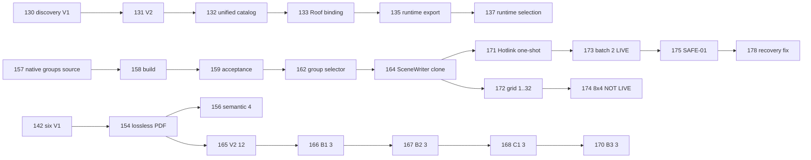

# APA AC29: карта незавершённых интеграций, 19.10.2026

Задача: `APA-P70.A11.S03`, единый реестр revision 183. У всех перечисленных PR статус draft/open на момент чтения GitHub. Номер PR и наличие зелёного CI не равны установленной или LIVE-принятой функции.

## Основные зависимости

Стрелки здесь обозначают базовые PR, а не разрешение выполнить зависимую LIVE-операцию. Полный список промежуточных веток и точных SHA находится в `pr-dependency-graph.json`. В HEAD #175 уже присутствует SHA #132, но ветки #172/#174 разошлись с Hotlink после общего `02cbbf92acdc33354569f8d2160dda57d7be4da0`: их новые файлы и изменения нельзя считать установленными в Hotlink-ветке.

## Матрица готовности

| Блок | Подтверждённая граница | Следующий конкретный результат |
| --- | --- | --- |
| #130–132 | Исходный каталог и групповые entrypoints повторно прочитаны; #132 является предком #175 | Продолжить существующий prepare_auto_optimized_native_task, без нового Router |
| #173 | Опубликована отдельная квитанция двух native Hotlink, 69→119 GUID, сохранённого снимка и reopen | Прежний пакет не переисполнять ради повторного доказательства |
| #175 / #178 | 44 локальных теста; исправлена проверка pinned snapshot receipt и скопированного ledger до native чтения | Отдельный LIVE SAFE-01 на новой копии с сохранением и reopen |
| #172 / #174 | 1–32 размещения в исходниках; #174 не содержит принятого сохранения/reopen | Перенести существующий grid и verifier без потери Hotlink; добавить сохранение и readback в копии |
| #156 | 4 semantic команды: установка и регистрация сообщены пользователем | Проверять текущую цепочку фабрики; не переустанавливать PyMuPDF и модели |
| #165–170 | 30 файловых команд; 3-элементный IFC B3 PASS прислан пользователем | Зафиксировать сообщение с правильным SHA, без выдуманного независимого чтения |

## Реальные ограничения native-команд

`MoveElements(copy=true)` — штатный Tapir batch. `CloneNativeGroupV1` — уже существующее расширение Tapir/SDK29 из #157: один JSON-вызов содержит несколько SDK Edit, поэтому он не объявляется одним SDK-вызовом или доказанным ускорением. Его действующий code-owned verifier ограничен двумя независимыми односегментными Column на нулевом этаже. Общие Beam/Object-группы, создание нового group+clone, булево объединение тел и произвольная композиция требуют отдельных проверяющих контрактов; одних схем недостаточно. Hotlink использует штатный `CreateHotlinkInstances`, существующий узел и проверенный модуль. Регулярная расстановка копий не создаёт архитектурные Grid-оси автоматически.

## Порядок исполнения

1. SAFE-01: закрыть выявленные кодовые пробелы, CI; LIVE отдельно при наличии управляемого нового экземпляра.
2. Существующие #172/#174: один Clone → полная сверка всех исходных и новых GUID/BREP/групп → один GuardedSave → снимок → фактическое закрытие/переоткрытие. LIVE заблокирован до SAFE-01.
3. Пользовательский запрос → квалифицированный intent → существующие discovery/Router/registry → тот же SceneWriter; unsupported остаётся fail-closed.
4. Только после завершения доступного приоритетного блока — подтверждённые sidecars и новые полезные read-only адаптеры по #163.

Автоматическая проверка безопасности отклонила активацию существующего окна grid для подготовки нового экземпляра. Три созданных в этом запуске пустых процесса без окна и порта были завершены; остальные окна/проекты не переключались. Нативных записей текущего этапа: 0. LIVE_PASS не присвоен.

## Точные ветки

| PR | HEAD SHA | Base PR |
| --- | --- | --- |
| [#128](https://github.com/dvikt33-ux/safe-bim-layer/pull/128) | `50ee7f5cc6852ce32251ed3ace85540e1ae92ae1` | 127 |
| [#129](https://github.com/dvikt33-ux/safe-bim-layer/pull/129) | `b080ea36b39c0ef71358e1a5c4659fdc4f3f56da` | 128 |
| [#130](https://github.com/dvikt33-ux/safe-bim-layer/pull/130) | `331a8d4f4ca96e031a562406923ac91a28fd4b63` | 129 |
| [#131](https://github.com/dvikt33-ux/safe-bim-layer/pull/131) | `75ae71dc60176225bb71928fb805e5adcc688b2e` | 130 |
| [#132](https://github.com/dvikt33-ux/safe-bim-layer/pull/132) | `30af6480860ff98995177b91acf47b676d4a52ac` | 131 |
| [#133](https://github.com/dvikt33-ux/safe-bim-layer/pull/133) | `74ad234c6975e2ea8a5139a17bf9ae63f820a3d8` | 132 |
| [#135](https://github.com/dvikt33-ux/safe-bim-layer/pull/135) | `4caaf8cbb27345b35f18c1cc3fe0dd129df60ca4` | 133 |
| [#137](https://github.com/dvikt33-ux/safe-bim-layer/pull/137) | `467d66d89059bd7fc27ed34d6dd62095f38511cf` | 135 |
| [#138](https://github.com/dvikt33-ux/safe-bim-layer/pull/138) | `d66c9a5500afa4886738815de50a7c5dafdf24fd` | 137 |
| [#139](https://github.com/dvikt33-ux/safe-bim-layer/pull/139) | `1ee4c8a52b0b7def1296b1fe414d419332b747f3` | 138 |
| [#141](https://github.com/dvikt33-ux/safe-bim-layer/pull/141) | `20e718451212f9cdcbab2aeacf2609640b4fbfd1` | 139 |
| [#142](https://github.com/dvikt33-ux/safe-bim-layer/pull/142) | `13d9ac866ab38bcc3e97bb383f68478e1b1242d8` | 139 |
| [#143](https://github.com/dvikt33-ux/safe-bim-layer/pull/143) | `49c676ce04b14c1376bc7629d6cb74426479bbdb` | feature/apa-ac29-reusable-copy-collision-gates-20261017 |
| [#144](https://github.com/dvikt33-ux/safe-bim-layer/pull/144) | `e116a486f5b02b019b232b3a7c9313bf349b3aab` | 143 |
| [#145](https://github.com/dvikt33-ux/safe-bim-layer/pull/145) | `e408dcc71914537e30e2c0dcd9b74e06d97c9a2e` | 144 |
| [#146](https://github.com/dvikt33-ux/safe-bim-layer/pull/146) | `06e85cf4f793207bd54503ceaa4183bcc61b165f` | 145 |
| [#147](https://github.com/dvikt33-ux/safe-bim-layer/pull/147) | `48b36020e8c9528d0993c4474e89b0f8ecd0457e` | 146 |
| [#148](https://github.com/dvikt33-ux/safe-bim-layer/pull/148) | `886068737d1cec1c314b101a0afc860f09061577` | 147 |
| [#149](https://github.com/dvikt33-ux/safe-bim-layer/pull/149) | `4c119428e9b1c24bd00774c91a6f33cbf26f0369` | 148 |
| [#150](https://github.com/dvikt33-ux/safe-bim-layer/pull/150) | `8fbb311fc2f25fb8b2b6ff432e74d4e31b4c93fc` | 149 |
| [#151](https://github.com/dvikt33-ux/safe-bim-layer/pull/151) | `6d4487d6b4ef34a0573de694c179335827d3b1fc` | 149 |
| [#153](https://github.com/dvikt33-ux/safe-bim-layer/pull/153) | `65eb58068f15fb2646e4a5a0464017741441bf6d` | 151 |
| [#154](https://github.com/dvikt33-ux/safe-bim-layer/pull/154) | `ca28e9b8003eeb3a38ca201ea96c0096e07b677f` | 142 |
| [#155](https://github.com/dvikt33-ux/safe-bim-layer/pull/155) | `68b38925e040d8954d40364abbb35cbb5e477ea6` | 153 |
| [#156](https://github.com/dvikt33-ux/safe-bim-layer/pull/156) | `40f909022def27ea30c6c45cf804b6cf059a0543` | 154 |
| [#157](https://github.com/dvikt33-ux/safe-bim-layer/pull/157) | `4b6cb12d9956f3f69a8bc377f0e5dc19396960bb` | 155 |
| [#158](https://github.com/dvikt33-ux/safe-bim-layer/pull/158) | `a6b8cea99adcd04b18737f6596d5a294306164b2` | 157 |
| [#159](https://github.com/dvikt33-ux/safe-bim-layer/pull/159) | `f13b1dcd70e9cb63f795e09fd25ada299e56f017` | 158 |
| [#162](https://github.com/dvikt33-ux/safe-bim-layer/pull/162) | `f7c37b84b76c040c417ccd58a5543326e50f673a` | 159 |
| [#163](https://github.com/dvikt33-ux/safe-bim-layer/pull/163) | `832a6e01823ffb9518b085299c3f8c007c1b7c2b` | research/apa-verified-results-hub-20261010 |
| [#164](https://github.com/dvikt33-ux/safe-bim-layer/pull/164) | `a04c6b44f2672cd58315eaba01708180f5a4d720` | 162 |
| [#165](https://github.com/dvikt33-ux/safe-bim-layer/pull/165) | `5c0dc009e729db9834301b4a369512490a205ef7` | 154 |
| [#166](https://github.com/dvikt33-ux/safe-bim-layer/pull/166) | `357d920d59ed129b1143751fa96b27e4b3bc326a` | 165 |
| [#167](https://github.com/dvikt33-ux/safe-bim-layer/pull/167) | `d6996124246a20b6760fc4688142ac7a1d890a29` | 166 |
| [#168](https://github.com/dvikt33-ux/safe-bim-layer/pull/168) | `7589c5dcee1fb71edae64e1d3bc9b1de14693e8e` | 167 |
| [#169](https://github.com/dvikt33-ux/safe-bim-layer/pull/169) | `21c6610a2bdff6faf17e1844a01bcb2dee09fe78` | 154 |
| [#170](https://github.com/dvikt33-ux/safe-bim-layer/pull/170) | `35a8b7b2fd78e63a6e13254d4c4fde26171793c8` | 168 |
| [#171](https://github.com/dvikt33-ux/safe-bim-layer/pull/171) | `b3a373243e10a4a6752b0b379c9b51005a663f73` | 164 |
| [#172](https://github.com/dvikt33-ux/safe-bim-layer/pull/172) | `9b7c2e93f93053c9ac306bc3a6a5c9f728b394aa` | 164 |
| [#173](https://github.com/dvikt33-ux/safe-bim-layer/pull/173) | `eee149369e9f4bec44ba176d13daf2c07558ce92` | 171 |
| [#174](https://github.com/dvikt33-ux/safe-bim-layer/pull/174) | `4ef970a1cef798aafbece4649af926b9f8f4e57a` | 172 |
| [#175](https://github.com/dvikt33-ux/safe-bim-layer/pull/175) | `24c198344a75dfa9a4515cca4df23badf3557d3d` | 173 |
| [#178](https://github.com/dvikt33-ux/safe-bim-layer/pull/178) | `a8cd4312a6a69b9f7773ebb01467ddf03cd8eac4` | 175 |
