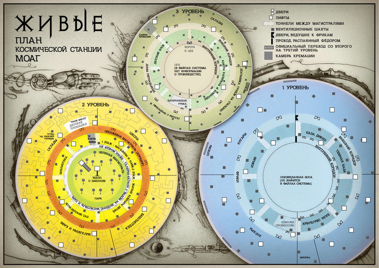

# МОАГ R11 — реальный MiniZinc + OR-Tools CP-SAT

Дата: 28.10.2026. База: PR #182, commit `51ebce6215e81ea2f16f18db75742d2f5b8c3754`.

**Работающий вычислительный прототип получен. Полная пространственная реконструкция не утверждена.**
На Windows действительно запущены MiniZinc 2.10.1 с готовым backend `cp-sat` (9.15)
и Python OR-Tools 9.14.6206. Собственного пространственного решателя нет: Python
адаптирует реестры, запускает официальные решатели и независимо проверяет ответы.

## Что реально выполнено

| Эксперимент | Нижний блок | Следующий участок: жилой Второй |
|---|---:|---:|
| Сущности из существующего индекса | 78 | 41 |
| Жёсткие ограничения проекции | 13: 9 высотных записей + 4 проверки плана | 3 высотных записи |
| Python CP-SAT | SAT | SAT |
| MiniZinc → готовый CP-SAT | SAT | SAT |
| Искусственное обратное отношение | INFEASIBLE | INFEASIBLE |
| Повторный запуск конфликтного ядра обоими способами | INFEASIBLE | INFEASIBLE |
| Разные наборы локальных отметок | 3, каждый принят MiniZinc | 3, каждый принят MiniZinc |

Число ограничений — число записей, а не независимых книжных доказательств:
например, R04 E71 и Z02 повторяют одно отношение. Концептуальные и уточнённые
индексы сохраняются раздельно; они не стали независимыми добавочными площадями.
Локально выполнены **149/149 тестов**, включая 7 новых, без пропусков.
Удалённая Windows/Linux проверка задаётся отдельным workflow
`.github/workflows/moag-solvers-r11.yml`; её фактический статус следует смотреть
на коммите PR, а не выводить из этого локального отчёта.

## Воспроизведение из корня репозитория

Требуется Python 3.11 x86_64 и доступ к PyPI/GitHub. MiniZinc скачивается из
официального релиза libminizinc, ZIP/TAR проверяется по закреплённому SHA256.
Windows-пакет не запускает системный установщик и не меняет PATH/реестр.
Библиотека Python `minizinc` не требуется: используется официальный CLI.

```powershell
python -m venv .venv
.\.venv\Scripts\python.exe -m pip install -r tools/moag_topology/requirements-r11.txt
.\.venv\Scripts\python.exe tools/moag_topology/bootstrap_r11.py
.\.venv\Scripts\python.exe tools/moag_topology/solver_r11.py --out r11-lower-run
.\.venv\Scripts\python.exe tools/moag_topology/solver_r11.py --scope 2 --out r11-second-run
.\.venv\Scripts\python.exe -m unittest discover -s tests -p test_moag_solver_r11.py -v
```

На Linux команды после установки зависимостей аналогичны, интерпретатор —
`.venv/bin/python`. Существующий MiniZinc можно передать `--minizinc /path/to/minizinc`.
Наличие backend `cp-sat` обязательно: автоматической подмены на Gecode нет.
При отсутствии решателя, ошибке или UNKNOWN эксперимент не получает PASS.

Исходная модель — `tools/moag_topology/solver_r11.mzn`. Каждый выходной каталог
содержит `model.json`, `sat.dzn`, `unsat.dzn`, `unsat-core.dzn`,
`alternative-*.mzn`, исходный stdout/stderr MiniZinc и `results.json`.
Индексы массивов соответствуют порядку `entities` в `model.json` (MiniZinc — с 1).

## Как подключены существующие данные

R09 строится существующей `reconcile_uncertainty_r09.build`, без нового графа:
593 узла / 845 рёбер. Отпечаток R09 проверяется до/после эксперимента.
Точная копия относящихся к области типизированных связей сохранена в sidecar;
пути персонажей, неизвестные сегменты, прямые проходы, гипотезы и отрицательные
тождественности не превращаются в одну категорию.

Строгие отношения высот читаются из исходных R04/R03,
`vertical_connections.json` и R06. Часть высотных записей не представлена
отдельным ребром в R09: они явно помечены `present_as_edge_in_R09=false`;
адаптер читает исходный регистр и не дописывает это ребро в R09.
Для сущностей сохранены индекс, имя, источники с полными URL,
домен глобального уровня, отдельный домен локального ранга, исходный профиль R05
и эпистемический статус. Три глобальных блока остаются 1/2/3; локальный ранг
не создаёт дополнительные глобальные уровни.

`z`, `plan_x`, `plan_y` — целые **порядковые свидетели**, не метры, отметки BIM
или готовые координаты плана. Верхняя граница равна числу сущностей, чтобы
хватило рангов для конечного строгого частичного порядка. Совпадение рангов
не доказывает общий пол, равные высоты или тождество помещений. Плановые ранги
других объектов, не ограниченных рисунком, также ничего не доказывают.

В модели нет сплошных перекрытий, непересечения геометрических объёмов,
маршрутных длин, точной оболочки, нормируемых проходов или времени движения.
Вложенность/связность/удалённость сохранены с исходной типизацией как сведения;
этот минимальный численный эксперимент решает строгий порядок, а не полную
геометрическую совместимость каждого сохранённого отношения.

Площади и высоты R05 **сохранены как сценарные гипотезы**. Их интервалы нельзя
превратить в книжные факты только потому, что решатель вернул SAT. В этом опыте
они не включены в жёсткие метрические ограничения. Производный численный
интервал объёма не придуман. SAT означает согласованность указанной проекции.

## Проверка книжных вертикальных отношений

Вновь прочитан искомый эпизод: [книга I, часть I, глава 3 «Таис. Закон»](https://knigalit.ru/avtori/varvara-enal/book2364884/chitat/?page=4).
Таис пропускает боковой выход вертикальной трубы и попадает на пол колодца.
Фёдор оказывается рядом; обратно они поднимаются по скобам к боковому повороту.
Оттуда технический лаз ведёт к мусоропрессовщику. Следует локальное отношение
«выход к обитаемой части выше пола колодца». Не следует «все базы выше всех
ангаров». Для `MOAG-G-0006` ранг представляет именно известный выход, а не пол
всего района баз. Глобальная принадлежность колодца не назначена: исходный
домен `[1,2,3]` сохранён как неизвестность индекса R09, а не как доказательство
размещения колодца на Втором/Третьем. Для полной вертикальной модели его нужно
дальше уточнять независимо от локального порядка.

Проверено описание [высокого зала и частичного мостика](https://knigalit.ru/avtori/varvara-enal/book2364884/chitat/?page=17):
мостик выше пола; занимает только часть периметра. Это не полная новая палуба.
Прочитаны страницы [первого ангара](https://loveread.ec/read_book.php?id=53370&p=14)
и [соседнего ангара](https://loveread.ec/read_book.php?id=53370&p=15):
верхние операторские/диспетчерские и лестницы сохраняются отдельными локальными
парами. Прямой переход между диспетчерскими не означает точного равенства Z.
Старый ангар P-313 и круглый зал P-220 не объединены.

Сведения об исторических номерах проверены на [странице B1-028](https://loveread.ec/read_book.php?id=48197&p=28).
В диалоге названы базы 3 и 4 из данных взломанных замков. Индивидуального
сопоставления этим номерам Темной и Овальной баз в прочитанной сцене нет.
`MOAG-G-0073` сохранён как общий исторический индекс; два новых помещения
не созданы. Привязка номеров остаётся **неизвестной**.

`B1-04` (КнигаЛит, глава) и `B1-004` (LoveRead, интернет-страница) — разные
системы адресации. Полные URL и разделы сохранены в `source_review.json` и
в ограничениях. Старые подтверждённые записи не переименованы.
Z04 (группа спален) и Z05 (неясный знак ступеней) не стали строгими фактами.
Другие ограничения переиспользованы из существующих реестров; это не заявление
о новой независимой перепроверке всего корпуса.

## Что проверено по предоставленным изображениям



В области Первого уровня читаются Темная слева, база диких сверху и Овальная
снизу. Четыре обязательных условия проверяют этот порядок по осям листа.
`plan_y` растёт вниз рисунка и никогда не используется как физическая высота Z.
План сохраняет отдельные три уровня и внутреннюю неизведанную зону. Точные
углы, радиусы, север и размеры по условному рисунку не вычислены.
Номера 3/4 на предоставленном плане индивидуально не установлены.


Внешний силуэт показывает три крупных расположенных друг над другом объёма,
купол и выступающие части. Это согласовано с сохранением трёх глобальных
блоков; точная совместимость внутренней геометрии с оболочкой ещё не решалась.
Рисунки получены от пользователя, сохранены побайтно с SHA256. Авторство и
издание по выходным данным независимо не аутентифицированы.

## Противоречие, альтернативы и границы готовности

Нижний UNSAT: к реальному E71 «мостик выше пола круглого зала» добавлен
`TEST-REVERSED-MOAG-RG-E71`, требующий обратного. CP-SAT возвращает ядро с
этими записями и книжной ссылкой. Это достаточное конфликтное множество;
минимальность общего алгоритма не заявляется. Ядро отдельно передано обоим
решателям и снова даёт UNSAT. Искусственная запись явно помечена тестовой,
никогда не становится книжным свидетельством.

Все три сохранённые альтернативы проходят независимую проверку отношений и
реальный MiniZinc с фиксированными переменными. Дополнительно оба решателя
нашли контрмодели «Темная выше первого ангара» и «Темная ниже первого ангара».
Оба случая остаются возможными, не установленными размещениями.

Выполнен и следующий ограниченный опыт на Втором: отдельная проекция локальных
ярусов жилой зоны (`second-results/`), с R06 POS06-001. Он не расширяет
доказательный граф и не связывает неизвестные коридоры.

**ГОТОВО для вычислительного прототипа:** реальный ввод → обе реализации SAT →
источниковый конфликт → UNSAT → повтор ядра → проверенные альтернативы → файлы.
**Ещё не ГОТОВО для полной пространственной реконструкции:** индивидуальная
привязка номеров 3/4, промежуточная геометрия маршрутов, объёмы, точная оболочка,
метрические интервалы и нормативная пригодность. Неизвестные вопросы собраны
в `source_review.json`, а не заполнены догадками. К большой 3D-визуализации
перехода нет. `main`, исходные R02–R10 и Archicad не изменены.

Официальные интерфейсы сверены по [MiniZinc solver backends](https://docs.minizinc.dev/en/stable/solvers.html)
и [Google CP-SAT](https://developers.google.com/optimization/cp/cp_solver).
